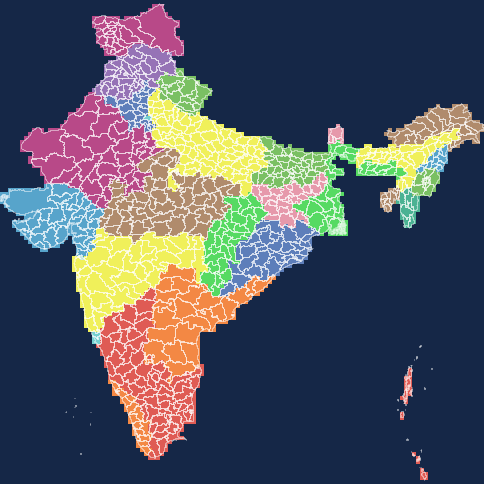

# GADM Boundary Loader for NetLogo

A minimal, reusable NetLogo template for map-based models. It loads administrative boundaries of India, fits the NetLogo world to them, colours each state and draws the boundaries.

**Author:** Ronit Jaiswal

## What it does

1. Loads the chosen GADM 4.1 level (`maps/gadm41_IND_1` to `gadm41_IND_3`) and its coordinate system.
2. Fits the NetLogo world to the dataset's envelope.
3. Copies each region's state name (`NAME_1`) onto the patches it covers and colours each state.
4. Draws the boundaries. The `click to identify state` button prints the state under the mouse.

## Data

| File | Level |
| --- | --- |
| `maps/gadm41_IND_1` | States and union territories |
| `maps/gadm41_IND_2` | Districts |
| `maps/gadm41_IND_3` | Sub-districts |

GADM data is free for academic and non-commercial use (gadm.org).

## Running

1. Install [NetLogo](https://ccl.northwestern.edu/netlogo/) (tested with 7.0.4).
2. Open `india-gis_1.nlogo`. (`india-gis.nlogo` holds the same code without the interface, for pasting into other models.)
3. Pick a `boundary-level` and press `setup`.

## Author

**Ronit Jaiswal**
