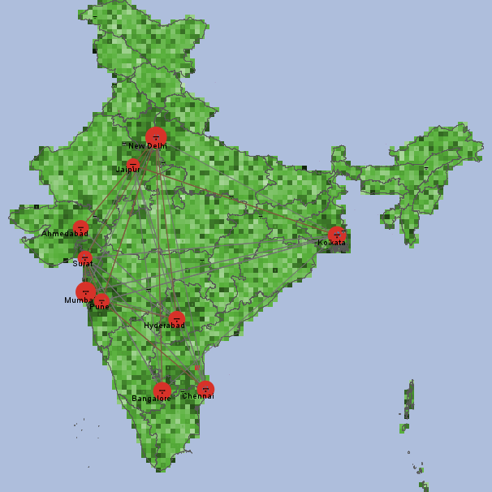
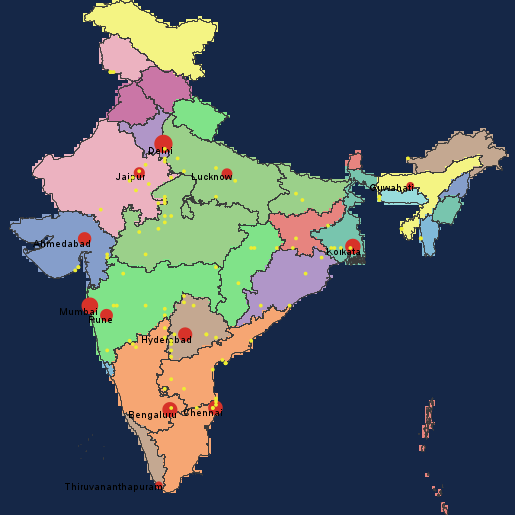

# India GIS Simulations in NetLogo

Two NetLogo models built on the state boundaries of India using the GIS extension.

**Author:** Ronit Jaiswal

  
  

## Models

| File | Description |
| --- | --- |
| `india_advanced_simulation.nlogo` | Full socio-economic simulation: cities, people, companies, transport, government, environment and events |
| `final_netlogo_model.nlogo` | Coloured state map, 12 cities at real coordinates, travellers moving between cities, click-to-inspect |
| `run_model.bat` | Opens the advanced model on Windows |

Both models are tested headless in NetLogo 7.0.4.

## Advanced simulation

**Agents**

- 10 major cities placed at their real latitude and longitude, with population, GDP per capita, growth rate, infrastructure, pollution, employment and migration attractiveness
- About 850 people of four types (urban, rural, migrant, tourist), with age, income, education, health, job sector and mobility
- Companies with revenue, employees and production capacity
- Highway and railway links between cities, and airports
- Government offices with budget and efficiency

**Patch indicators:** GDP, industrial, agricultural and service levels, pollution, water availability, forest cover, temperature, rainfall, road density, power, internet, education, healthcare and unemployment.

**Each tick (one month)**

- **Environment:** monsoon cycle, pollution spreading from industry, drought, rising temperature
- **Economy:** city output grows from the national base rate, scaled by environment, infrastructure and education; employment moves towards a growth-dependent level
- **Population and migration:** urban growth and migration towards attractive cities; tourists move between destinations
- **Transport:** traffic and freight flows, maintenance decay, congestion
- **Policy:** infrastructure, education and healthcare programmes, pollution regulation
- **Events:** festivals, harvests, monsoon floods, natural disasters, economic booms and technology spread

**Views:** economic, environmental, population, transport and development.

**Plots:** national GDP, average pollution, development and unemployment.

## Data

| Folder | Content |
| --- | --- |
| `map/` | India state boundaries (`india_boundary.shp`, field `ST_NM`) |
| `indianDistrictShapefile/` | District boundaries |
| `data/` | Natural Earth countries and states |
| `delhi_map/` | Delhi buildings, roads and hospitals |

See `setup_instructions.md` and `manual_download_guide.md` for downloading or replacing boundary data.

## Running

1. Install [NetLogo](https://ccl.northwestern.edu/netlogo/) (tested with 7.0.4).
2. Open `india_advanced_simulation.nlogo` (or run `run_model.bat` on Windows).
3. Press `setup`, then `go`. Use the view buttons to switch map layers.

## History

`CHANGELOG.md` lists the fixes that made the advanced model open and run correctly. Earlier versions and the format workaround scripts are kept in `archive/`.

## Author

**Ronit Jaiswal**
