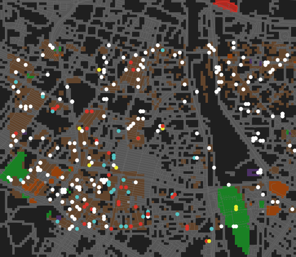
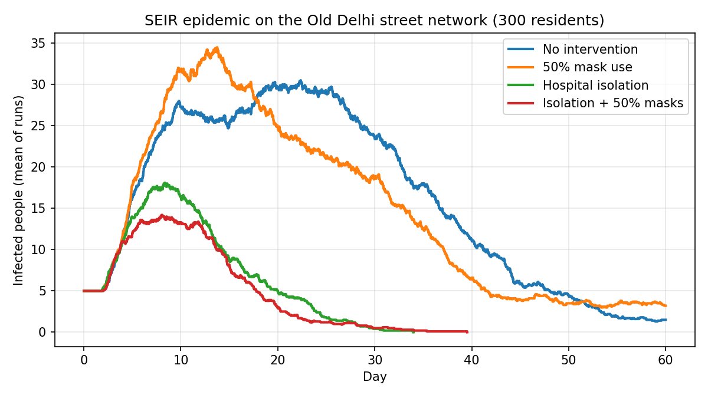

# SEIR Epidemic on the Old Delhi Street Network

A NetLogo agent-based model of an epidemic spreading among residents who commute along the real streets of the Subzi Mandi area of Old Delhi.

**Author:** Ronit Jaiswal



*White: susceptible. Yellow: exposed. Red: infected. Cyan: recovered. Brown patches are residential buildings, orange commercial, green public, violet religious; grey patches are roads; the hospital is at the top.*

## Data

The `map/` folder holds OpenStreetMap layers (ODbL):

| Layer | Content | Use in the model |
| --- | --- | --- |
| `delhi_buildings.shp` | 2,229 building footprints | Land use of each patch from the OSM `building` tag |
| `delhi_roads.shp` | 1,885 road segments (residential to primary roads, footways) | Patches that people walk along |
| `delhi_hospitals.shp` | Northern Railway Hospital | Isolation destination |

## How it works

- **Time:** one tick is 10 minutes; 144 ticks make one day.
- **Residents:** each lives in a residential building and has a workplace, school or market as a destination. Each leaves home between 07:00 and 09:00 and returns between 16:00 and 19:00.
- **Movement:** people walk greedily along road patches towards their goal, stepping off the road only to enter the destination or to cross gaps in the network.
- **Transmission:** an infected person exposes each susceptible person on the same patch with probability `transmission-chance` per tick. Masks halve the chance of passing infection on and cut the chance of catching it by 30 percent.
- **Progression:** exposed people become infectious after `incubation-days`; infected people recover with immunity after `recovery-days`. Both periods vary randomly between 50 and 150 percent of the slider value.
- **Isolation:** with `hospital-isolation?` on, infected people move to the hospital one day after symptoms begin and stop transmitting until they recover.

## Controls

| Control | Meaning |
| --- | --- |
| `population` | Number of residents |
| `initial-infected` | Infected at the start |
| `transmission-chance` | Infection probability per 10-minute contact (%) |
| `incubation-days`, `recovery-days` | Mean duration of the exposed and infected states |
| `mask-usage` | Share of residents wearing masks (%) |
| `walk-speed` | Patches walked per tick |
| `max-days` | Simulation length limit |
| `hospital-isolation?` | Isolate symptomatic cases in hospital |

Monitors show the day, the count in each state, the number in hospital, the peak and its day, the attack rate and total infections. A plot shows the SEIR curves.

## Experiments

`experiments/scenarios.xml` runs no intervention, 50 percent masks, hospital isolation and both combined, 10 times each.

```bash
netlogo-headless --model diseaseSpreading.nlogo --threads 4 \
    --setup-file experiments/scenarios.xml --table experiments/scenarios.csv
python experiments/analyse_results.py
```

| Scenario | Peak infected | Peak day | Attack rate | Epidemic length |
| --- | ---: | ---: | ---: | ---: |
| No intervention | 40.2 | 16.8 | 43.8 % (sd 15.7) | 49.7 days |
| 50 % mask use | 31.2 | 18.5 | 34.2 % (sd 13.7) | 53.8 days |
| Hospital isolation | 20.5 | 8.1 | 11.6 % (sd 5.6) | 25.5 days |
| Isolation + 50 % masks | 15.8 | 7.3 | 7.8 % (sd 3.8) | 20.8 days |



Hospital isolation has a large and consistent effect. The effect of masks at 50 percent use is smaller than the run-to-run variation at 10 repetitions.

## Running

1. Install [NetLogo](https://ccl.northwestern.edu/netlogo/) (tested with 7.0.4).
2. Open `diseaseSpreading.nlogo`.
3. Set the sliders, press `setup`, then `go`.

## Author

**Ronit Jaiswal**
