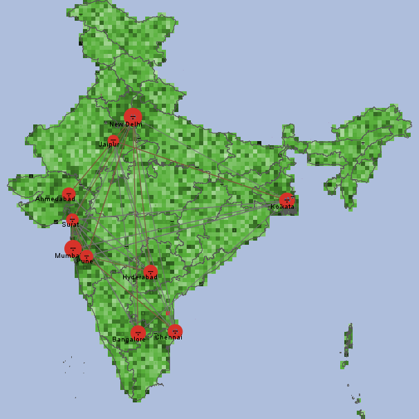
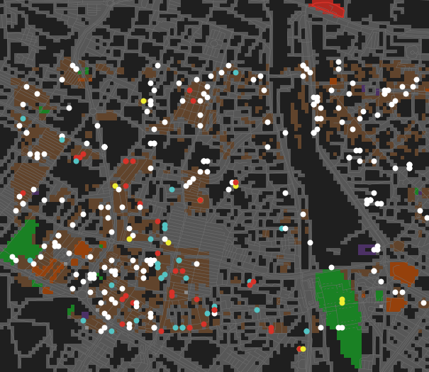
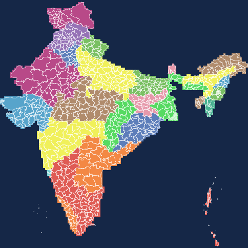
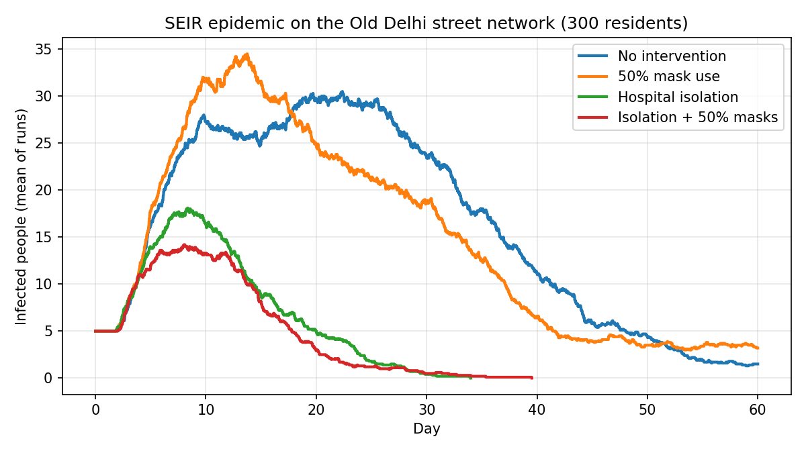
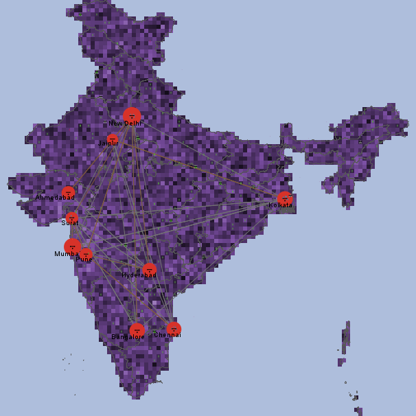
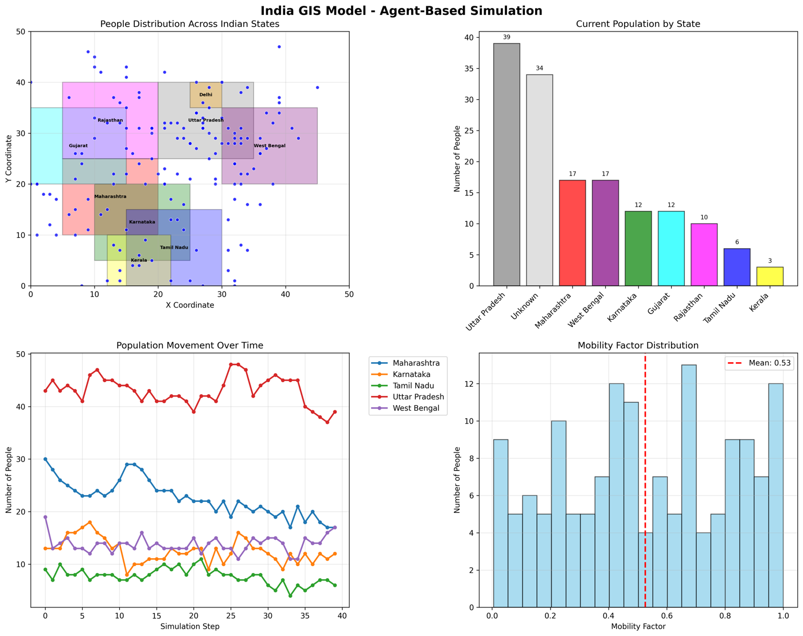

# India GIS Agent-Based Simulations

Agent-based models built on real geographic data for India, developed during my internship at the Indian Institute of Space Science and Technology (IIST). The work combines GIS shapefiles with NetLogo and Python (Mesa) to simulate people, cities, economies and epidemics on real maps, from the whole country down to individual streets in Old Delhi.

**Author:** Ronit Jaiswal

<p>
  
  
  
</p>

---

## Projects

| Folder | What it is | Scale | Tools |
| --- | --- | --- | --- |
| [`Gis_disease`](Gis_disease/) | SEIR epidemic among commuters on the real Old Delhi street network, with intervention experiments | City | NetLogo, GIS extension, OpenStreetMap |
| [`Gis_Netlogo`](Gis_Netlogo/) | National simulation of India: cities, migration, economy, environment, transport and policy | Country | NetLogo, GIS extension |
| [`PYTHON_MESA`](PYTHON_MESA/) | Python re-implementation with Mesa, GIS data tools, and NetLogo control from Python | Country | Python, Mesa, pandas, Matplotlib |
| [`GISnetlogo3`](GISnetlogo3/) | Reusable template for loading and colouring administrative boundaries | Country | NetLogo, GADM 4.1 |

Every NetLogo model here is tested headless in NetLogo 7.0.4. The Python models have smoke tests that run in CI.

---

## 1. Epidemic on the Old Delhi street network (`Gis_disease`)

An SEIR model (susceptible, exposed, infected, recovered) in the Subzi Mandi area of Old Delhi. It uses 2,229 OpenStreetMap building footprints and 1,885 road segments.

- 300 residents live in residential buildings and walk the real street network to workplaces, schools and markets each day, leaving between 07:00 and 09:00 and returning between 16:00 and 19:00. One tick is 10 minutes.
- Infection passes through contact on the same patch: on the street, at work and inside shared homes overnight.
- Interventions: mask use (halves outgoing and cuts incoming transmission by 30 percent) and hospital isolation, where symptomatic people go to the Northern Railway Hospital one day after symptoms start.

**Experiment results** (10 runs per scenario, 5 initial cases, 60 days; reproducible from `Gis_disease/experiments/`):

| Scenario | Peak infected | Peak day | Attack rate | Epidemic length |
| --- | ---: | ---: | ---: | ---: |
| No intervention | 40.2 | 16.8 | 43.8 % (sd 15.7) | 49.7 days |
| 50 % mask use | 31.2 | 18.5 | 34.2 % (sd 13.7) | 53.8 days |
| Hospital isolation | 20.5 | 8.1 | 11.6 % (sd 5.6) | 25.5 days |
| Isolation + 50 % masks | 15.8 | 7.3 | 7.8 % (sd 3.8) | 20.8 days |



Isolating symptomatic people cuts the attack rate by roughly three quarters and halves the length of the outbreak. That effect holds across both experiment sets. The effect of 50 percent mask use is smaller than the run-to-run variation at 10 runs: it lowered the attack rate in the scenario runs but peaked slightly higher in the independent curve runs. Separating it reliably would need more repetitions.

## 2. National simulation of India (`Gis_Netlogo`)



`india_advanced_simulation.nlogo` loads the state boundaries of India and overlays a multi-agent socio-economic system:

- **Agents:** 10 major cities at their real coordinates, about 850 urban, rural, migrant and tourist agents, companies, highways, railways, airports and government offices.
- **Patch indicators:** GDP, industry, agriculture, services, pollution, water, forest cover, temperature, rainfall, road density, power, internet, education, healthcare and unemployment.
- **Dynamics (one tick = one month):** monsoon cycle, pollution spread, climate drift, city growth and employment, migration towards attractive cities, transport flows, government policy, festivals, disasters and economic booms.
- **Views:** economic, environmental, population, transport and development, plus plots of national GDP, pollution, development and unemployment.

`final_netlogo_model.nlogo` is a lighter companion model: states coloured individually, 12 cities, travellers moving between cities in proportion to population, and click-to-inspect states.

## 3. Python and Mesa implementation (`PYTHON_MESA`)



The India model rebuilt in Python. It comes as a Mesa version (`india_gis_model.py`) and a dependency-light version (`india_final_working.py`). There are also data tools that download Natural Earth boundaries and generate state, city, economic and migration datasets, and a notebook that drives NetLogo from Python through pyNetLogo.

## 4. Boundary loader template (`GISnetlogo3`)

A minimal, reusable starting point for any map-based NetLogo model. It loads GADM 4.1 boundaries at state, district or sub-district level, fits the world to them, colours each state and identifies states on click.

---

## Running

**NetLogo models:** install [NetLogo](https://ccl.northwestern.edu/netlogo/) (tested with 7.0.4; the GIS extension is bundled), open any `.nlogo` file, press `setup` and then `go`.

**Python models:**

```bash
cd PYTHON_MESA
python -m venv .venv
.venv\Scripts\activate            # Windows
pip install -r requirements.txt
python india_gis_model.py
pytest -q tests
```

**Disease experiments (headless):**

```bash
cd Gis_disease
netlogo-headless --model diseaseSpreading.nlogo --threads 4 \
    --setup-file experiments/scenarios.xml --table experiments/scenarios.csv
python experiments/analyse_results.py
```

## Repository structure

```
.
|-- Gis_disease/          SEIR model, Delhi OSM layers, experiments and analysis
|-- Gis_Netlogo/          National models, India boundary and district data
|-- PYTHON_MESA/          Python / Mesa models, data tools, notebook, tests
|-- GISnetlogo3/          GADM boundary loader template
|-- docs/images/          Screenshots and result figures
`-- .github/workflows/    CI for the Python models
```

Older drafts that are kept for reference live in each project's `archive/` folder.

## Key concepts demonstrated

- Agent-based modelling of epidemiological, social and economic systems
- Rasterising vector GIS data onto simulation patches (`gis:apply-coverage`, `gis:intersecting`)
- Placing agents by latitude and longitude (`gis:project-lat-lon`)
- Movement constrained to a real road network
- Designed experiments with BehaviorSpace, run headless, with statistical summaries
- Porting a model between NetLogo and Python (Mesa)

## Data sources and credits

- OpenStreetMap contributors: Delhi buildings, roads and hospital (ODbL)
- GADM 4.1: administrative boundaries of India (academic and non-commercial use)
- Natural Earth: country and state boundaries (public domain)
- NetLogo: Wilensky, U. (1999). Center for Connected Learning and Computer-Based Modeling, Northwestern University.
- Mesa: agent-based modelling framework for Python

## Author

**Ronit Jaiswal**
GitHub: [Ronitjaiswal1](https://github.com/Ronitjaiswal1)

## License

Code is released under the MIT License (see `LICENSE`). Map data remains under the terms of its original source.
